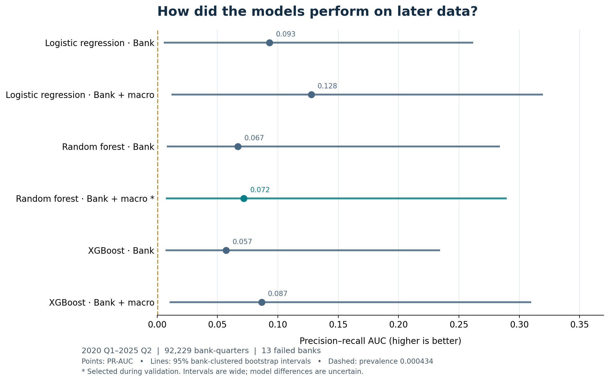

# Predicting U.S. Commercial Bank Failure

Can publicly available financial and economic data help prioritise banks for review before failure? This project compares Logistic Regression, Random Forest and XGBoost using chronological validation and a later historical test.

The research was completed for an MSc Business Analytics dissertation at The University of Manchester by Reinaldi Yuri Artha. It brings together financial risk, rare-event modelling and practical limits on review capacity.



*Figure: Historical final-test precision–recall AUC (PR-AUC), with 95% bank-clustered bootstrap intervals. The highlighted Random Forest was selected during validation. The chart uses the original aggregate results supplied with the project.*

## What the research found

- Validation: Random Forest with bank and macroeconomic predictors had the highest mean validation PR-AUC, 0.343, and was selected before the final test.
- Later test: Logistic Regression with macroeconomic predictors had the highest PR-AUC point estimate (0.128); the selected Random Forest scored 0.072. Confidence intervals were wide and overlapped, so these results do not establish a statistically distinct winner.
- Review capacity: When the top 1% of banks were ranked each quarter, both Random Forest specifications and bank-only XGBoost captured 7 of the 13 distinct failed banks at least once in a positive pre-failure quarter.

The final test covers 2020 Q1–2025 Q2, with 92,229 bank-quarter observations, 40 positive bank-quarters and 13 distinct failed banks. Findings are historical and uncertain; the small number of failures limits generalisation. Precision–recall AUC is a measure of the precision–recall trade-off across score thresholds and depends on event prevalence.

## Data and methodology

| Step | Approach |
| --- | --- |
| Data | FFIEC Call Reports, FDIC failure records and FRED macroeconomic data. The final panel contains 579,394 bank-quarter observations from 2001 Q2 to 2025 Q2. |
| Target | Failure within days 1–365 after a reference quarter. Bank and macroeconomic predictors are taken from the exact previous quarter, so the time from source report to failure varies and is longer than the target window alone. |
| Features | 19 bank inputs, including a history indicator; the extended specification adds four macroeconomic indicators. |
| Validation | Three purged expanding-window folds: 2010–2012, 2013–2015 and 2016–2018. A 2019 purge precedes the 2020–2025 final test. |
| Preprocessing | Training-fold median imputation and 1st/99th-percentile winsorisation; Logistic Regression is also standardised. Class weights address imbalance. |

The selected model was determined by the unweighted mean of the three validation PR-AUC values. The same final-test calendar had been examined under an earlier project version; the research design and selection procedure were fixed before this evaluation.

## Explore the project

| Location | What it contains |
| --- | --- |
| [`notebooks/`](notebooks/) | The 17 research notebooks, organised from data audit through final evaluation. |
| [`results/`](results/) | Original aggregate final-test CSVs and simplified tables checked against the submitted dissertation. |
| [`scripts/plot_final_test.py`](scripts/plot_final_test.py) | A small example that recreates the figure above from the included aggregate results. |
| [`docs/NOTEBOOK_DEPENDENCIES.md`](docs/NOTEBOOK_DEPENDENCIES.md) | A map of notebook inputs, handoffs and known compatibility questions. |
| [`docs/REPRODUCIBILITY.md`](docs/REPRODUCIBILITY.md) | What is needed to rerun and verify the full analysis. |

### Recreate the figure

With Python and Matplotlib installed, run:

```bash
python scripts/plot_final_test.py
```

The script reads the included final-test results CSV and writes `figures/final_test_pr_auc.png`. It visualises saved results; it does not train models or reproduce predictions. This example was tested in the preparation environment; package versions have not been locked.

### Research notebook status

The code cells were checked against the supplied originals; headings and review messages were simplified without changing the analysis logic. The full research workflow was originally run in Google Colab with a specific Google Drive folder structure. The notebooks still contain those original path and configuration assumptions; some Phase 1 and Phase 2 handoffs use different filenames. Raw data and intermediate outputs are not included. The full pipeline has not been independently rerun from this repository. See the dependency and reproducibility notes before attempting a full run.

## Limitations and responsible interpretation

- The final test contains few failures, so estimates and operational capture are uncertain.
- Class-weighted scores are treated as rankings, not calibrated failure probabilities or automatic intervention rules.
- Current-vintage macroeconomic data may contain later revisions, and feature selection was not nested within each validation fold.
- The crisis-period analysis is exploratory. Feature importance and associations should not be interpreted as causal effects.
- The work supports historical research and screening, not live bank monitoring.

## Data sources

- [FFIEC Central Data Repository](https://cdr.ffiec.gov/public/)
- [FDIC Failed Bank List](https://www.fdic.gov/bank-failures/failed-bank-list)
- [Federal Reserve Economic Data (FRED)](https://fred.stlouisfed.org/)

Raw data snapshots, exact retrieval details and source terms should be checked before attempting full reproduction. No raw bank-level dataset or dissertation PDF is included here. Project licence and third-party sharing permissions remain to be confirmed.

## Related work

The Medium article and Power BI dashboard are in preparation; links will be added when they are available.
